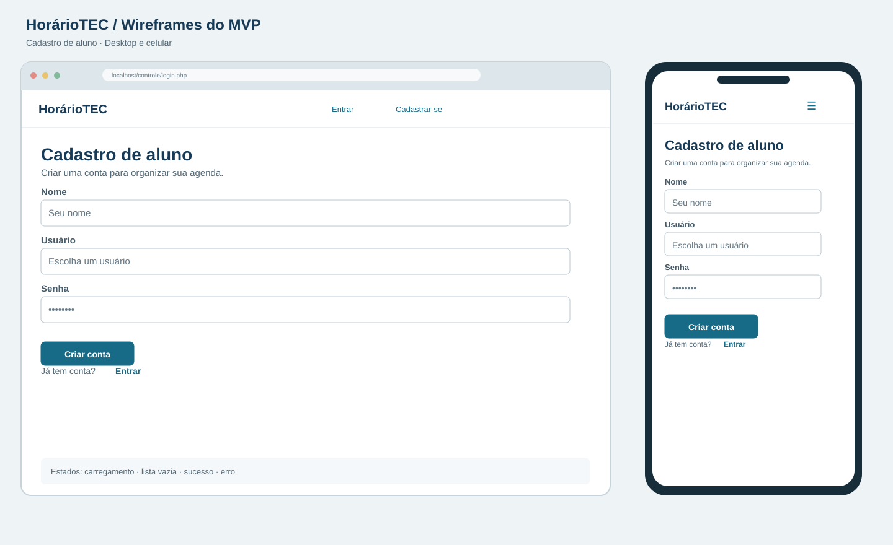
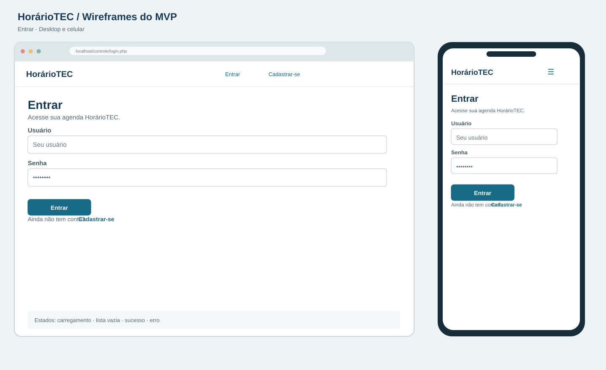
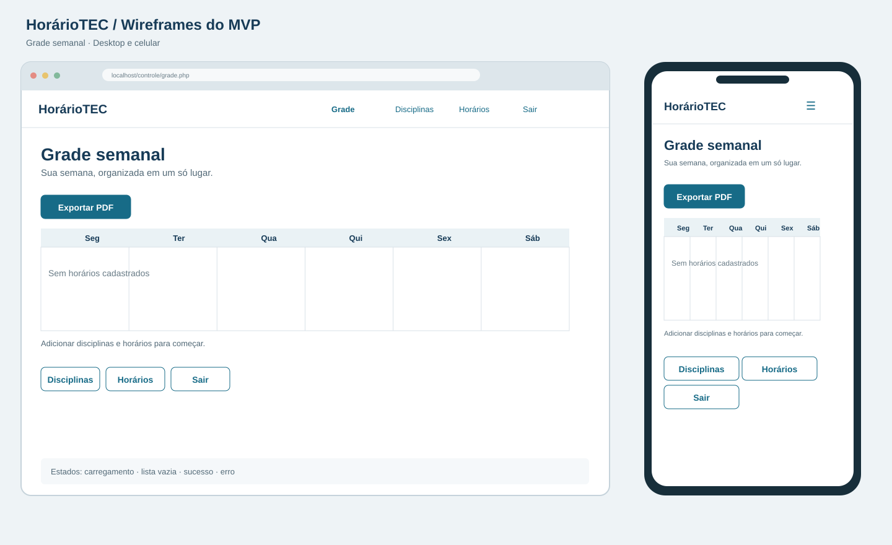
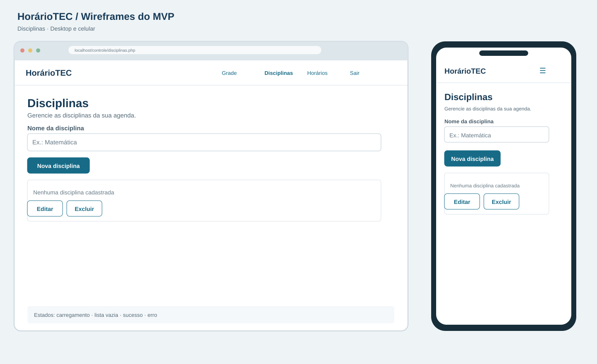
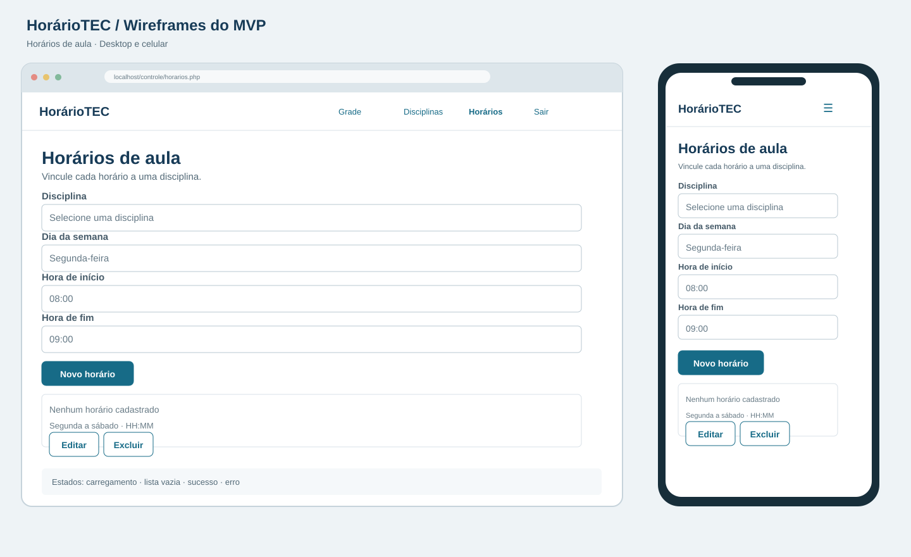
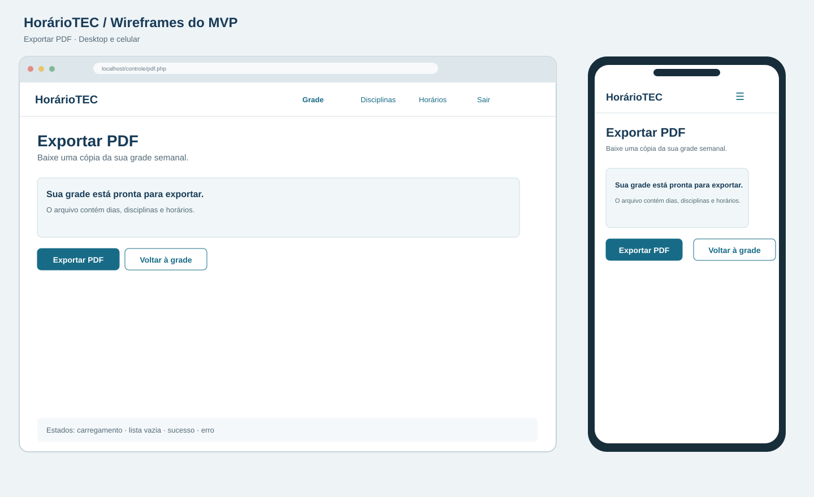

# DESIGN.md — HorárioTEC

## Objetivo

Este documento registra a proposta de interface do MVP HorárioTEC e serve como referência para implementar as telas. O sistema ajuda estudantes do ensino técnico federal a manter uma agenda individual de aulas, consultar a semana e exportá-la em PDF.

A interface deve priorizar tarefas claras, mensagens compreensíveis e uso confortável em celular e computador. Os wireframes relacionados abaixo são propostas visuais; a implementação deve manter as regras e o escopo definidos em `PRODUCT.md`.

## Princípios de interface

- **Foco no fluxo principal:** cadastro → login → disciplinas → horários → grade → PDF.
- **Agenda individual:** após login, todas as listas e operações pertencem ao aluno autenticado.
- **Ações evidentes:** usar rótulos textuais como “Salvar”, “Editar”, “Excluir” e “Exportar PDF”; não depender só de ícones.
- **Resposta clara:** mostrar sucesso, validação, conflito e falha perto do conteúdo ou formulário relacionado.
- **Simplicidade responsiva:** formulários em uma coluna no celular e grade semanal consultável também em telas estreitas.
- **Operação sem JavaScript:** as páginas e formulários funcionam com carregamento tradicional do navegador.

## Estrutura de navegação

### Visitante

- **Entrar** é a tela inicial de quem ainda não tem sessão.
- **Cadastrar-se** abre o formulário de criação de conta.
- Após cadastro, a pessoa segue para o login.

### Aluno autenticado

O menu oferece **Grade**, **Disciplinas**, **Horários** e **Sair**. A grade é a tela principal após o login. A exportação em PDF é acionada a partir da grade. Sair encerra a sessão; uma nova tentativa de abrir uma página interna retorna ao login.

### Mapa do fluxo

```text
Visitante → Entrar ────────────→ Grade semanal → Exportar PDF
              ↕                       ↕
         Cadastrar-se             Disciplinas
                                      ↕
                                   Horários
                                      ↓
                             salvar sem conflito
                                      ↓
                                  Grade semanal

Qualquer tela autenticada → Sair → Entrar
```

## Direção visual proposta

Os wireframes usam uma linguagem simples de produto acadêmico: fundo azul acinzentado muito claro, superfícies brancas, texto azul escuro, azul petróleo para ações principais e bordas discretas. Essa paleta é uma proposta dos wireframes, não uma identidade visual institucional.

| Uso | Cor de referência | Aplicação |
|---|---|---|
| Azul escuro | `#173B57` | Títulos, marca e elementos de navegação |
| Azul petróleo | `#176B87` | Ações principais e links |
| Fundo claro | `#EEF3F6` | Fundo ao redor do conteúdo |
| Superfície | `#FFFFFF` | Formulários, listas e áreas de conteúdo |
| Texto secundário | `#526977` | Ajuda, descrições e informação complementar |
| Borda | `#D9E1E8` | Separadores, tabelas e campos |
| Fundo de destaque | `#EAF2F5` | Cabeçalhos de dias e áreas informativas |

Usar fonte de sistema sem serifa, títulos com hierarquia clara e espaçamento suficiente para leitura. Erros devem ser distinguíveis por texto e posição, além de cor. As ações destrutivas devem parecer secundárias e sempre solicitar confirmação antes da exclusão.

## Layout responsivo

### Computador

- Cabeçalho com HorárioTEC à esquerda e links de navegação à direita.
- Conteúdo centralizado, com largura que preserve a leitura dos formulários e listas.
- Na grade, apresentar segunda a sábado como colunas; cada bloco contém o nome da disciplina e a faixa `HH:MM–HH:MM`.
- Mensagens de estado aparecem antes ou junto ao conteúdo que descrevem.

### Celular

- Cabeçalho compacto, com navegação recolhida ou disposta em itens empilhados.
- Campos e botões ocupam a largura disponível e ficam em coluna única.
- Manter rótulos explícitos, áreas de toque confortáveis e texto sem cortes.
- Na grade, permitir rolagem horizontal dos seis dias, mantendo o dia identificável durante a consulta.
- Não ocultar ações importantes em interações que dependam de JavaScript.

## Telas

### 1. Cadastro de aluno

Criar conta com **nome**, **usuário** e **senha**. Nome e usuário têm os limites definidos no produto (100 e 50 caracteres). O usuário é único. O botão principal é **Criar conta**; **Entrar** leva ao login.

- **Sucesso:** confirmar a criação e seguir para o login.
- **Erro:** informar campo inválido ou usuário já utilizado; preservar os valores não sensíveis para correção.
- **Carregamento:** o navegador mostra o envio tradicional do formulário.
- **Lista vazia:** não aplicável.



### 2. Login

Solicitar **usuário** e **senha**. O botão principal é **Entrar** e o link **Cadastrar-se** abre o cadastro. Após autenticar, direcionar para a grade.

- **Sucesso:** abrir a grade semanal.
- **Erro:** usar mensagem genérica “Usuário ou senha incorretos.” sem revelar qual dado falhou.
- **Carregamento:** indicação de envio/navegação do navegador.
- **Lista vazia:** não aplicável.



### 3. Grade semanal

Mostrar os dias de segunda a sábado em colunas e posicionar cada aula no dia correspondente. Cada bloco identifica disciplina e início/fim. Oferecer **Exportar PDF**, **Disciplinas**, **Horários** e **Sair**.

- **Sucesso:** mostrar os horários atuais da conta após carregar/recarregar a página.
- **Vazia:** manter os dias visíveis, mostrar “Você ainda não tem horários cadastrados.” e orientar a pessoa a cadastrar disciplinas e horários.
- **Erro:** mensagem amigável de falha ao carregar; nunca substituir a grade por dados de outra conta.
- **Carregamento:** navegação tradicional do navegador.



### 4. Disciplinas

Listar as disciplinas do aluno e oferecer criação, edição e exclusão. Criar e editar usam um campo **Nome da disciplina**; o formulário pode ser reaproveitado com título e ação adequados. A exclusão deve pedir confirmação e informar que os horários vinculados também serão removidos.

- **Sucesso:** atualizar a lista após salvar ou excluir.
- **Vazia:** mostrar “Nenhuma disciplina cadastrada.” e a ação **Nova disciplina**.
- **Erro:** indicar nome vazio ou duplicado (“Já existe uma disciplina com esse nome.”) sem perder o formulário.
- **Carregamento:** indicação do navegador durante navegação ou envio.



### 5. Horários de aula

Listar horários com disciplina, dia, hora de início e fim. Criar e editar usam os campos **Disciplina**, **Dia da semana**, **Hora de início** e **Hora de fim**. A disciplina selecionável deve pertencer ao aluno. Dias vão de segunda a sábado e horários usam formato 24 horas `HH:MM`.

- **Sucesso:** atualizar a lista; ao voltar à grade, a alteração deve estar refletida.
- **Vazia:** convidar a adicionar horário. Se não houver disciplinas, orientar a cadastrá-las primeiro.
- **Erro:** manter valores informados e explicar fim menor/igual ao início ou conflito no mesmo dia. Horário conflitante não pode ser gravado.
- **Carregamento:** indicação do navegador durante navegação ou envio.
- **Exclusão:** pedir confirmação antes de remover o horário.



### 6. Exportação em PDF

A ação **Exportar PDF** começa na grade e gera um arquivo da agenda da sessão atual, contendo disciplinas, dias e faixas de horário. Não há formulário nem escolha de outro usuário.

- **Sucesso:** iniciar o download e permitir retornar à grade pelo navegador.
- **Sem horários:** gerar PDF sem aulas e incluir aviso claro de agenda vazia.
- **Erro:** informar que não foi possível gerar o arquivo e orientar a voltar à grade/tentar novamente.
- **Carregamento:** o navegador indica a transferência do arquivo.



## Padrões de formulários e mensagens

- Todo campo tem rótulo visível e obrigatório indicado quando necessário.
- Usar `required` e limites de caracteres alinhados ao produto nos formulários.
- Horários seguem `HH:MM`; a hora final precisa ser maior que a inicial.
- Mensagens de erro ficam próximas ao formulário e explicam como corrigir.
- Mensagens de sucesso confirmam a ação realizada e não aparecem indefinidamente.
- Confirmações precedem exclusões; excluir uma disciplina informa sobre a remoção em cascata dos horários.
- Após gravações, usar o padrão POST → redirect → GET para evitar reenvio acidental.

## Estados de tela

| Estado | Tratamento visual e comportamento |
|---|---|
| Carregamento | Nas páginas tradicionais, confiar no indicador de carregamento/envio do navegador; não simular carregamento parcial. |
| Lista vazia | Explicar que não há itens e oferecer a próxima ação possível. |
| Sucesso | Atualizar ou redirecionar para a lista/grade com confirmação clara. |
| Erro | Preservar o contexto e valores corrigíveis; apresentar mensagem amigável sem detalhes técnicos. |
| Conflito de horário | Reexibir o formulário com os dados informados, indicar o choque e não gravar o horário. |

## Acessibilidade e legibilidade

- Usar `lang="pt-BR"`, codificação UTF-8, títulos em ordem hierárquica e contraste legível.
- Associar cada `label` ao respectivo campo; manter foco e ordem de leitura coerentes.
- Não comunicar erro, seleção ou estado apenas por cor.
- Usar texto em botões e links que explique seu destino/ação.
- Em telas estreitas, priorizar rolagem do conteúdo da grade em vez de reduzir demais as colunas e textos.

## Arquivos de referência

- `PRODUCT.md`: escopo e critérios funcionais do MVP.
- `navegacao.md`: descrição do fluxo, campos, ações, mensagens e estados por tela.
- `wireframes/cadastro.svg`
- `wireframes/login.svg`
- `wireframes/grade.svg`
- `wireframes/disciplinas.svg`
- `wireframes/horarios.svg`
- `wireframes/pdf.svg`

## Fora do desenho do MVP

Não criar interface para recuperação de senha por e-mail, compartilhamento de agenda, administração de contas, notificações, blocos de estudo ou opções avançadas de personalização do PDF. O MVP é web; os wireframes para celular representam layout responsivo do navegador, não um aplicativo nativo.
